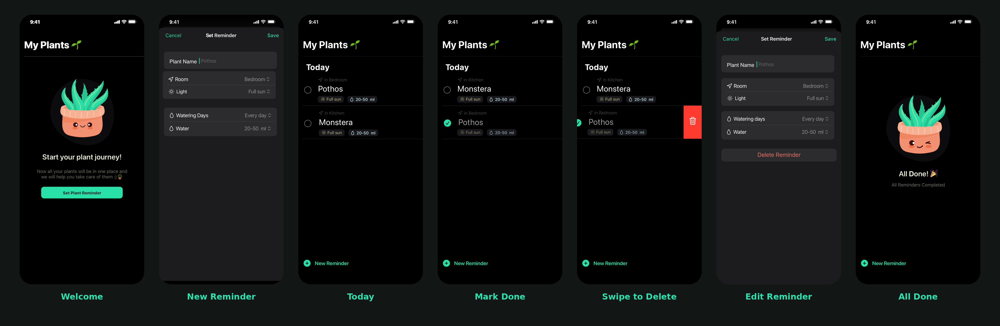

<div align="center" style="margin-bottom: 30px;">

# Planto 🌱🪴

**Now all your plants are in one place, and we help you take care of them**

</div>

---

## 📍 About Planto 📍
Planto is a simple and friendly iOS app that helps you take care of your plants. Set a watering reminder for each plant, check it off when you're done, and enjoy a celebration once all of today's reminders are completed.

---

## 🌟 Key Features

- **Plant Reminders** 🪴⏰: Create a reminder for every plant in your home
- **Room & Light Info** 📍☀️: Record where each plant lives and how much light it needs
- **Watering Schedule** 💧: Choose the watering days and the amount of water
- **Quick Check-off** ✅: Tap to mark a plant as watered
- **Swipe to Delete** 🗑️: Remove a reminder with a single swipe
- **Dark Mode UI** 🌙: A clean, calm dark interface with a fresh green accent

---

## 💻 Tech Stack

- 🚀 **Swift and SwiftUI**: Core application development
- 🛠️ **Xcode**: Development environment, with unit and UI test targets
- 🎨 **Sketch**: User interface design and prototyping
- 🐙 **GitHub**: Version control

---

## 📱 Screens Overview

1. **Welcome Screen (👋)**
   - Friendly intro, "Start your plant journey!", and a **Set Plant Reminder** button.

2. **Set Reminder (📝)**
   - Enter the plant name, then pick its room, light, watering days, and water amount.
   - **Cancel** or **Save** from the top bar.

3. **Today (📅)**
   - Shows all of today's plant reminders with room, light, and water amount.
   - Tap the circle to complete a reminder.

4. **Mark Done (✅)**
   - Completed plants are checked off and dimmed.

5. **Swipe to Delete (🗑️)**
   - Swipe a reminder to reveal the delete action.

6. **Edit Reminder (✏️)**
   - Update any detail of an existing reminder, or tap **Delete Reminder**.

7. **All Done (🎉)**
   - A cheerful message when every reminder is completed, with a quick **New Reminder** shortcut.

<div align="center" style="margin: 20px 0;">



</div>

---

## 📂 File Structure

```
planto_app
├── plant.xcodeproj   # Xcode project file
├── plant             # App source code (SwiftUI views, models, assets)
├── plantTests        # Unit tests
├── plantUITests      # UI tests
└── README.md
```

---


## 🎨 Design

- **Style:** Dark interface with a mint green accent
- **Mascot:** A cute winking plant pot that greets you on empty and completed states
- **Tool:** Sketch

---

## ℹ️ More Information

[🔗 Repository](https://github.com/Alshaimaa00/planto_app)

---
